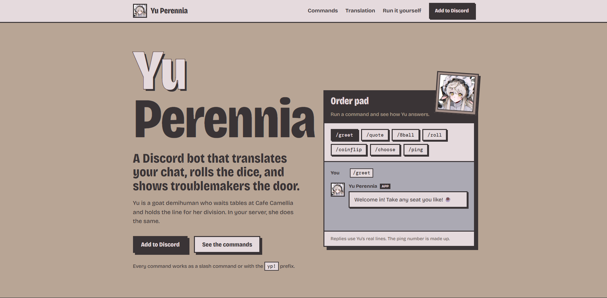

 <div align="center">

# Yu Perennia

**A cheerful, modular Discord bot ready to serve your community.**

[](https://discordpy.readthedocs.io/)
[](https://www.python.org/)
[](https://www.deepl.com/)
[](LICENSE)
[]()


</div>

---

## Features

### General Commands

Fun and interactive commands to engage your community.

| Command | Description |
|---|---|
| `greet` | Receive a warm greeting from Yu. |
| `ping` | Check the bot's latency. |
| `info` | Learn about Yu and her capabilities. |
| `quote` | Get an encouraging message. |
| `say` | Make Yu repeat your message. |
| `roll` | Roll a six-sided die. |
| `8ball` | Ask Yu a question and receive a fortune. |
| `coinflip` | Flip a coin. |
| `choose` | Let Yu choose from multiple options. |

### Moderation

Tools to help keep your server safe and organized.

| Command | Description |
|---|---|
| `kick` | Remove a member from the server with the appropriate permissions. |

### Translation

Powered by the DeepL API, Yu can help bridge language barriers in your community.

- **Automatic translation:** Configure channels to translate into a language of your choice. The input language is auto-detected by default, or set one to translate both ways between two languages.
- **On-demand translation:** Translate individual messages, with an optional input language.
- **Channel controls:** Enable or disable automatic translation as needed.
- **Supported languages:** English, Spanish, Mandarin Chinese, Simplified Chinese, Traditional Chinese, French, German, Arabic, Hindi, Japanese, Russian and Portuguese.

*Translation features require a DeepL API key.*

### Voice (Text-to-Speech)

Yu can read a text channel aloud in your voice channel, so people without a mic can still join in.

- **Join and read:** `/vcjoin` makes Yu join your voice channel and read messages from the channel you ran it in. She leaves immediately when no people are left with her.
- **Auto-join:** only for the voice channels you pick. Run `/server-settings auto-join toggle` while you're in a voice channel (or `/server-settings auto-join add <voice channel>`) and Yu joins that channel by herself when someone enters it, reading its own chat. Other voice channels are never auto-joined.
- **Only listeners are read:** messages are spoken only for people in Yu's voice channel.
- **Voices:** `/user-settings vcsetvoice` picks your own voice; `/server-settings vcsetvoice` sets the server default. Your voice wins over the server's.
- **Pronunciation list:** gaming and chat slang (`gg`, `lol`, `afk`, ...) is expanded from `config/commands/tts_config.yaml`, with no size limit.
- **Housekeeping:** Yu leaves when the channel empties, drops messages when the queue is full, and skips anything that isn't text.

*Voice runs on [edge-tts](https://github.com/rany2/edge-tts) (no API key) and needs FFmpeg and libopus. The included `Dockerfile` installs both.*

### Ask Yu

Ask Yu a question and she answers using Google Gemini Flash-Lite.

- **`/ask`:** Yu answers in the text channel.
- **`/vcask`:** Yu answers out loud in your voice channel (and types the answer too). If she isn't in a voice channel she joins yours; she uses your own voice setting, then the server's.
- **Chat mode (`/vcchatmodetoggle`):** staff turn it on per text channel. Yu then stops reading that channel aloud and instead answers what people in her voice channel type, as if she were part of the conversation: she keeps a short-term memory of the channel's last few messages (per channel, in RAM only, forgotten on restart or when chat mode is toggled), speaks in the server's voice, types the reply too and stays quiet when people are just talking to each other.
- **The prompt:** Gemini gets a structured prompt (`<role>`, `<situation>`, `<rules>`, `<memory>`, `<output_format>`) built in `src/services/commands/ask_service.py`; only Yu's persona is edited in `config/commands/ask_config.yaml`.
- **Limits:** questions are capped at 1000 characters and there is a short per-person cooldown. Both are set in `config/commands/ask_config.yaml`.

*Ask features require a Gemini API key (`GEMINI_API_KEY`).*

### Developer Features

Designed with modularity and maintainability in mind.

- **Dynamic autoloader:** Automatically discovers and loads commands and events.
- **Centralized logging:** Console and file-based logging for debugging.
- **YAML configuration:** Customize command settings and responses without changing application code.
- **Modular architecture:** Separate commands, events, services, utilities, and UI components.
- **SQLite support:** Planned persistent storage for future features.

---

## Requirements

- Python 3.11 or later
- `discord.py` 2.4.0 or later
- A Discord bot token
- A DeepL API key (optional; required for translation features)
- FFmpeg and libopus (optional; required for voice, installed by the `Dockerfile`)

---

## Getting Started

### 1. Clone the Repository

```bash
git clone https://github.com/yourusername/yu-perennia-bot.git
cd yu-perennia-bot
```

### 2. Install Dependencies

```bash
pip install -r requirements.txt
```

### 3. Configure Environment Variables

Copy `.env.example` to `.env` and provide your credentials.

```env
DISCORD_TOKEN=your-discord-bot-token
DEEPL_API_KEY=your-deepl-api-key
GOOGLE_TRANSLATE_API_KEY=your-google-cloud-translation-key
GEMINI_API_KEY=your-gemini-api-key
```

Both translation keys are optional. DeepL powers `/translate` and, by default, translating voice channel messages; `GOOGLE_TRANSLATE_API_KEY` is only needed if a server picks Google with `/server-settings translate-api`.

`GEMINI_API_KEY` (from [Google AI Studio](https://aistudio.google.com/apikey)) powers `/ask`, `/vcask` and chat mode (`/vcchatmodetoggle`). It is optional: without it `/ask` and `/vcask` tell people Yu isn't set up for questions, and chat mode stays quiet. `GEMINI_MODEL` can override the model (default `gemini-3.5-flash-lite`).

### 4. Run the Bot

```bash
python src/main.py
```

---

## Usage

Yu supports both **slash commands** and **prefix commands** using `yp!`.

### General Commands

| Slash Command | Prefix Command | Description |
|---|---|---|
| `/greet` | `yp!greet` | Greets the user. |
| `/ping` | `yp!ping` | Displays bot latency. |
| `/info` | `yp!info` | Displays bot information. |
| `/quote` | `yp!quote` | Shares an encouraging message. |
| `/say <message>` | `yp!say <message>` | Repeats the provided message. |
| `/roll` | `yp!roll` | Rolls a six-sided die. |
| `/8ball <question>` | `yp!8ball <question>` | Answers with a fortune. |
| `/coinflip` | `yp!coinflip` | Flips a coin. |
| `/choose <options>` | `yp!choose option1\|option2\|option3` | Chooses from the provided options. |

### Moderation Commands

| Slash Command | Prefix Command | Description |
|---|---|---|
| `/kick <user> [reason]` | `yp!mod kick <user> [reason]` | Kicks a member from the server. |

### Translation Commands

| Command | Description |
|---|---|
| `/translate to:French` | Auto-translates the current channel into French. The input language is auto-detected; anything already in French is translated into English. Prefix form: `yp!translate french`. |
| `/translate to:French from:Japanese` | Translates between Japanese and French in the current channel (both ways). Prefix form: `yp!translate french from:japanese`. |
| `/translate to:Japanese text:Hello!` | Translates the provided text into Japanese. Add `from:` to set the input language (default: auto-detect). For two-word names in prefix commands, use quotes, e.g. `yp!translate "Traditional Chinese" Hello!`. |
| `/translate off` | Disables automatic translation in the current channel. |

### Ask Commands

| Command | Description |
|---|---|
| `/ask <question>` | Yu answers your question in this channel. |
| `/vcask <question>` | Yu answers your question out loud in your voice channel (and types it here). |
| `/vcchatmodetoggle [on\|off]` | Staff only (Manage Server). Chat mode for the channel you run it in (empty = flip it): Yu doesn't read its messages aloud but joins the conversation, with per-channel short-term memory. Needs `GEMINI_API_KEY`. |

### Voice Commands

| Command | Description |
|---|---|
| `/vcjoin` | Yu joins your voice channel and reads this text channel. |
| `/vcleave` | Yu leaves the voice channel. |
| `/leave` | Same as `/vcleave`. |
| `/user-settings vctoggle <on\|off\|reset>` | Turns Yu reading *your* messages in voice channels on or off (remembered). Beats the server's setting; `reset` follows the server again. |
| `/user-settings vcsayname <on\|off\|reset>` | Whether Yu says your name before reading your messages (on by default). Beats the server's setting; `reset` follows the server again. |
| `/user-settings vcsetvoice [voice]` | Sets the voice used for your messages. Empty = use the server's voice. Beats the server's voice. |
| `/server-settings auto-join toggle [enabled]` | Staff only (Manage Server). Turns auto-join on or off for the voice channel you're currently in. Empty = flip it. Yu reads the chat of the voice channel she joins. |
| `/server-settings auto-join add <voice channel>` | Staff only (Manage Server). Makes Yu auto-join that voice channel. |
| `/server-settings auto-join remove <voice channel>` | Staff only (Manage Server). Stops Yu auto-joining that voice channel. |
| `/server-settings auto-join list` | Shows the voice channels Yu auto-joins. |
| `/server-settings vctoggle [on\|off]` | Staff only (Manage Server). Turns Yu reading messages in voice channels on or off for the whole server (on by default). People can override it for themselves with `/user-settings vctoggle`. |
| `/server-settings vcsayname [on\|off]` | Staff only (Manage Server). Whether Yu says the speaker's name before reading messages in this server (on by default). People can override it for themselves with `/user-settings vcsayname`. |
| `/server-settings vctranslatetoggle [on\|off]` | Staff only (Manage Server). Whether Yu translates other languages to English before reading them out in this server (on by default, server-wide only). |
| `/server-settings translate-api [deepl\|google]` | Staff only (Manage Server). Which service translates voice channel messages. Google needs `GOOGLE_TRANSLATE_API_KEY`. `/translate` always uses DeepL. |
| `/server-settings vcgreettoggle [on\|off]` | Staff only (Manage Server). Yu says "Welcome, <name>!" when someone joins her voice channel and "Goodbye, <name>!" when they leave. Off by default. |
| `/server-settings vcsetvoice [voice]` | Staff only (Manage Server). Default voice for people who haven't picked their own. Empty = reset. |

Exact command syntax may vary depending on the implemented command handlers and configuration.

---

## Configuration

### Command Prefix

Edit `config/bot_defaults.py` to change the default prefix.

```python
DEFAULT_PREFIX = "yp!"
```

### Command Settings

Customize command behavior and messages through the YAML files in `config/commands/`.

- `general_config.yaml` — General commands and responses.
- `mod_config.yaml` — Moderation settings.
- `utility_config.yaml` — Utility command settings.
- `translate_config.yaml` — Translation settings and messages.
- `tts_config.yaml` — Voice list, pronunciation replacements and voice command messages.

### Supabase config store (optional)

Config can also live in Supabase, so you can edit it from the website's `/admin` dashboard.

1. Create a Supabase project and run the files in `supabase/migrations/` (in order) in the SQL editor.
2. Generate an admin key (`openssl rand -hex 32`) and register its hash with the `insert into public.admin_keys ...` statement at the bottom of the first migration.
3. Set `SUPABASE_URL` and `SUPABASE_SERVICE_KEY` in the bot's `.env`, then run `python scripts/seed_supabase.py` to upload the YAML files.
4. Set `PUBLIC_SUPABASE_URL` and `PUBLIC_SUPABASE_ANON_KEY` in `packages/website/.env` and open `/admin`.

On startup the bot loads the YAML files, then overrides them with whatever is in the `bot_config` table. If Supabase isn't configured or can't be reached, the YAML values are used. The bot re-checks config every 6 hours; the dashboard's **Refresh bot** button makes it reload config files and translation channels within about 30 seconds. Slash-command descriptions (shown in Discord's menu) are fixed at startup and still need a restart. Yu's **status** (online/idle/DND and the activity text) is also set from the dashboard and picked up within about 30 seconds, no restart needed. Until you save one, she shows the default in `src/cogs/events/cog_presence.py`.

**Translation channels** are stored in the `translate_channels` table too. `/translate` writes to it, the bot re-reads it every minute, and the dashboard's *Translation channels* panel can add, change or remove channels (so changes apply without a restart). The local `data/translate_channels.json` stays as an offline cache. `seed_supabase.py` also uploads any channels already saved in that file.

---

## Project Structure

```text
yu-perennia-bot/
├── config/
│   ├── commands/
│   ├── bot_defaults.py
│   ├── directories.py
│   └── system_details.py
├── scripts/
│   └── seed_supabase.py
├── supabase/
│   └── schema.sql
├── src/
│   ├── cogs/
│   │   ├── commands/
│   │   └── events/
│   ├── core/
│   ├── datastore/
│   ├── factories/
│   ├── services/
│   ├── ui/
│   ├── utils/
│   └── main.py
├── tests/
├── .env.example
├── .gitignore
├── LICENSE
└── requirements.txt
```

---

## Contributing

Contributions are welcome. You can help improve Yu by:

- Reporting bugs and unexpected behavior.
- Suggesting new features.
- Submitting pull requests.

Please ensure your changes are tested and consistent with the project's existing architecture.

---

## License

This project is licensed under the [MIT License](LICENSE).

---

## Acknowledgments

- [discord.py](https://discordpy.readthedocs.io/) — Python wrapper for the Discord API.
- [DeepL](https://www.deepl.com/) — Translation API.
- Character concept and inspiration: Yu Perennia, the goat girl waitress of Cafe Camellia.

<div align="center">

**Made with ☕ by Yu Perennia**

*“Welcome in! Leave it to me!”* 🐐

</div>
